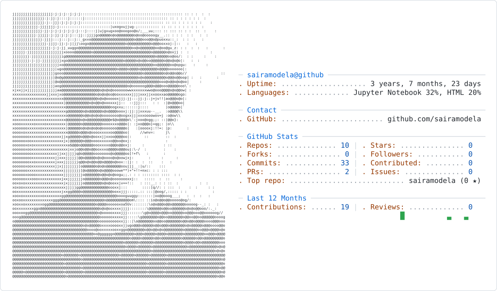

  <picture>
    <source media="(prefers-color-scheme: dark)" srcset="dark_mode.svg">
    
  </picture>

  

---

### 🚀 About Me

- 💻 **Software Engineer** building enterprise AI platforms and RESTful APIs with **Python (FastAPI)** and **AWS**
- 🧠 Working with **Generative AI, LLMs, RAG pipelines** and **LLM observability** (Langfuse)
- 🔌 Into **Model Context Protocol (MCP)** and multi-agent systems
- 🛠️ Passionate about clean, maintainable code — from design to production
- 📍 Hyderabad, India

---

### 🛠️ Tech Stack

  

---

### 🔥 Featured Projects

| Project | What it is | Stack |
|---------|-----------|-------|
| [Signature-Verification](https://github.com/sairamodela/Signature-Verification) | ML classifier distinguishing genuine vs forged signatures — 96% accuracy | Python, scikit-learn, Flask |
| [Fake-News-Detection](https://github.com/sairamodela/Fake-News-Detection) | ML-powered fake news detection on 44K articles — 98%+ accuracy | Python, TF-IDF, Flask |
| [Room-Arena](https://github.com/sairamodela/Room-Arena) | Local ferry interconnecting AI agent chats into one room | Python, Playwright |
| [Movie_Recommendation_System](https://github.com/sairamodela/Movie_Recommendation_System) | Movie recommendation engine | Python |

---

### 📫 Connect with me

  
    
  

---

  
    
  

